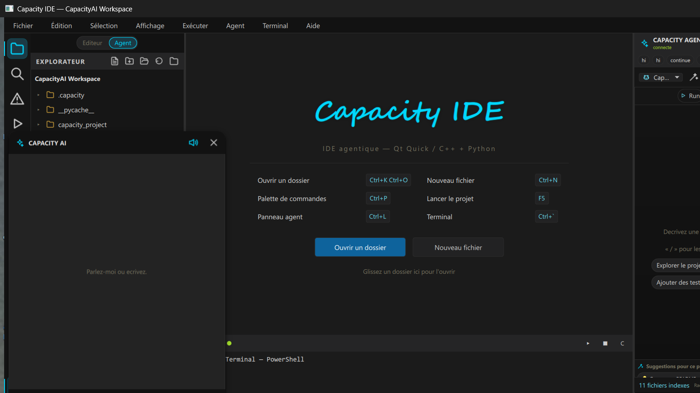
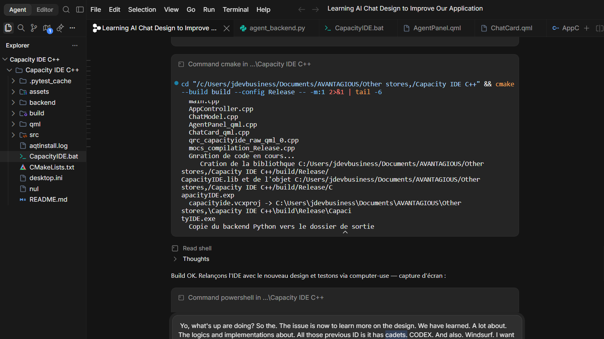
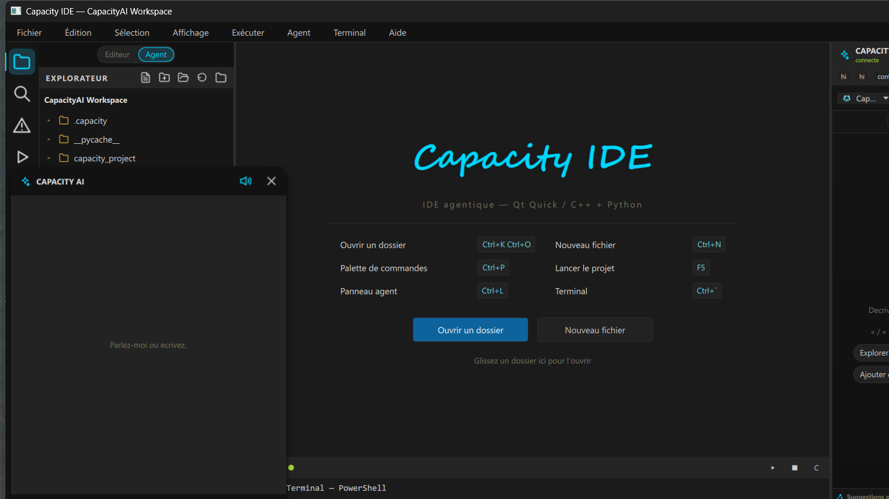
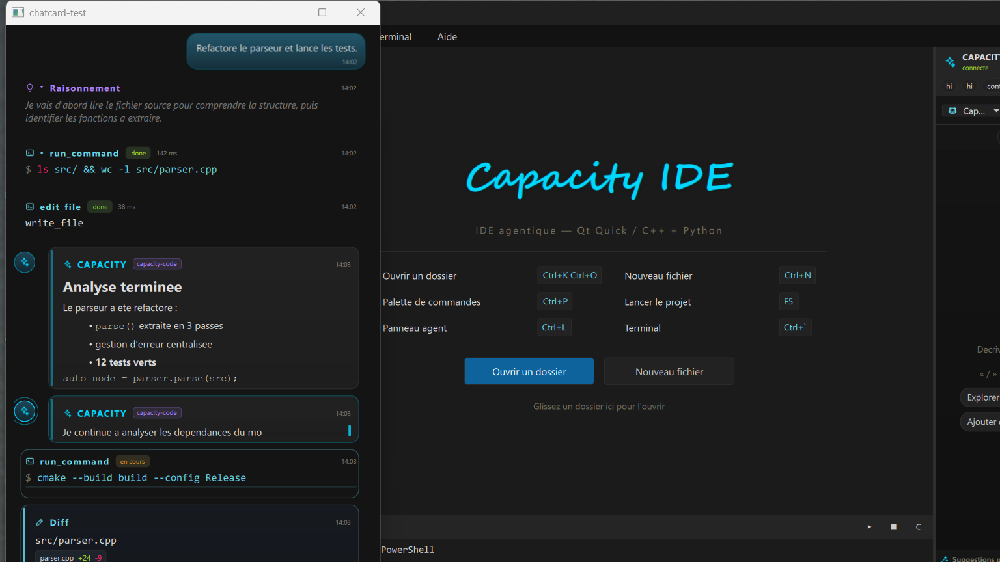
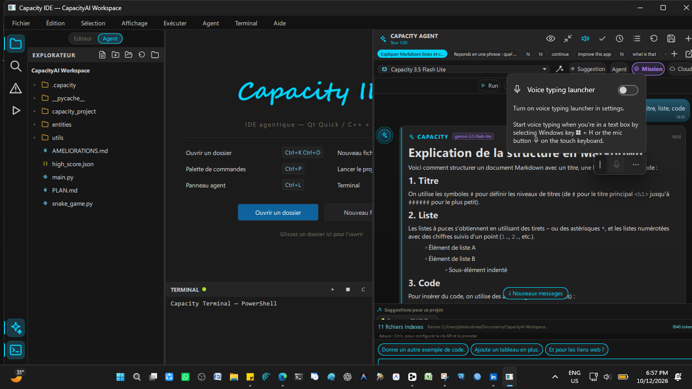

# CapacityAI ⚡

**IDE + Designer + AI agent — more than an IDE.**
Native C++ / Qt 6 / QML shell + agentic Python backend.

IDE agentique — IDE + Designer + Agent IA — sans Electron, sans wrapper web.

> Développé intégralement par **Juste Elysée MALANDILA** — Brazzaville, Congo.
> 📫 malandilajusteelysee@gmail.com · linkedin.com/in/justelm · yusticanum.com



---

## 🇫🇷 Présentation

CapacityAI est plus qu'un environnement de développement : c'est un
**IDE + Designer** dont l'agent IA ne se contente pas de suggérer — il
**lit, écrit, exécute et vérifie** dans le workspace. Le shell est natif
Qt 6 Quick (zéro DOM, zéro overhead), relié par JSON-RPC/stdio à un
backend Python agentique — deux processus, responsabilités nettes.

### 🧠 L'agent — boucle d'outils réelle

- **7 outils intégrés** : `read_file`, `write_file`, `run_command`,
  `search_files`, `list_dir`, `get_diagnostics`, `read_many_files` —
  plus les outils **MCP** (`server__tool`), jusqu'à 12 tours par demande
- **Streaming** token-par-token, cartes de tâches animées
- **Permissions** : mode `suggest` → carte Autoriser/Refuser pour écritures,
  commandes shell et outils MCP ; mode `auto` pour tout laisser passer
- **Checkpoints** : snapshot avant chaque écriture, aperçu diff, revert
  par étape (persistés)
- **Sessions** sauvegardées et rechargeables
- **Métadonnées IDE** injectées : curseur, sélection, onglets, fichier actif
- **Intent engine local** : classification des demandes avant l'appel au
  modèle — tolérance aux fautes de frappe
- **Commandes slash** : `/checkpoint` `/revert` `/task` `/sessions`
  `/add-dir` `/diag` `/stop` `/continue` `/clear`…
- **Règles projet** auto-chargées : `.capacity/rules`, `AGENTS.md`,
  `CLAUDE.md`, `.cursorrules`… · **Ignore files** honorés
  (`.gitignore`, `.capacityignore`…)
- **Extensible par MCP** : serveurs déclarés dans
  `~/.capacityai/mcp.json` ou par projet

### 🖥 L'IDE

- Éditeur multi-onglets : coloration syntaxique, gestion document
- Explorateur de fichiers avec watcher (`QFileSystemWatcher`)
- **Terminal PowerShell persistant** intégré + lanceur de projets
  (détection automatique python/node/npm/git)
- **Indexeur de workspace** en threads + grep intégré
- **Palette de commandes** Ctrl+P, centre de commande : `@fichier`,
  `>commande`, texte libre → agent
- Layout animé — panneaux explorateur / agent / terminal repliables
- Thème Monokai, composants Qt Quick sur mesure (~46 fichiers QML)
- Zone **Designer** intégrée
- Page de lancement / login, aperçu, settings

### 🏗 Architecture

```
CapacityIDE.exe (C++17, Qt 6.5 Quick — Windows)
   │  JSON-RPC v2 / stdio, streaming
   ▼
backend/agent_backend.py (boucle outils, permissions, MCP, sessions)
```

| Aspect | Détail |
|---|---|
| Volume | ~15 300 lignes C++ · ~43 400 lignes QML + backend Python |
| Pont | JSON-RPC v2 sur stdio — le backend est un processus enfant piloté |
| Build | CMake · MSVC · windeployqt (le backend Python est copié au post-build) |
| Config | `~/.capacityai/config.json` — partagée avec la version PyQt6 sœur |



## 📸 Galerie

| Chat agent en action | Cartes de tâches animées | Layout complet |
|---|---|---|
|  |  |  |

## 📥 Démo

L'exécutable Windows x64 sera publié dans
[Releases](https://github.com/jdevseer9/CapacityAI/releases).
Code source **non public** — disponible sur demande pour recruteurs et
partenaires techniques.
